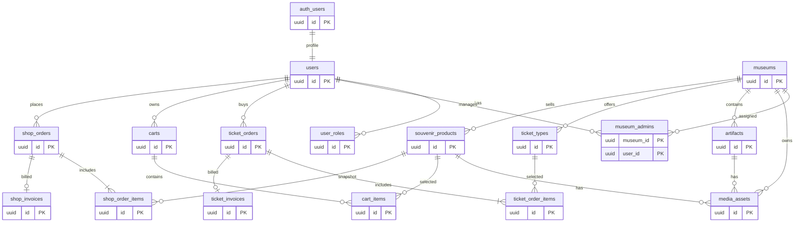

# Thiết kế database — Hệ thống quản lý bảo tàng

## 1. Phạm vi và nguyên tắc thiết kế

Thiết kế này dành cho một Supabase project, sử dụng:

- **Supabase Auth** (`auth.users`) cho đăng nhập bằng Gmail/password và OTP.
- PostgreSQL schema `public` cho dữ liệu nghiệp vụ.
- UUID cho khóa chính và `timestamptz` lưu thời gian theo UTC.
- Drizzle ORM/migrations để quản lý schema; các trigger, function và RLS phức tạp được viết bằng SQL migration có version-control.
- RLS trên toàn bộ bảng nghiệp vụ.
- Tiền tệ bằng `numeric(12,2)`, không dùng floating point.
- Ảnh/video lưu trong Supabase Storage; database chỉ lưu metadata và đường dẫn object.

### 1.1. Quyết định về mô hình người dùng

Hệ thống có **một identity duy nhất cho mỗi người** trong `auth.users`. Không tạo một tài khoản Auth thứ hai khi một người dùng được cấp quyền quản lý. Việc “admin user của normal user tự động được tạo” được triển khai an toàn như sau:

1. Khi Auth user đăng ký, trigger tạo một dòng tương ứng trong `public.users` và gán role mặc định `normal_user`.
2. Khi người dùng được cấp quyền quản lý, hệ thống thêm role `admin_user` và/hoặc thêm dòng trong `museum_admins`; không tạo bản sao email, mật khẩu hay identity.
3. Một người có thể vừa là `normal_user` vừa là `admin_user`. Role là quyền ứng dụng, còn `museum_admins` là phạm vi bảo tàng mà người đó được quản lý.
4. Không cho client tự chọn hoặc tự cấp role admin. Việc cấp role phải qua backend tin cậy hoặc quy trình quản trị đã được phê duyệt.

Cách này đáp ứng hai role chính, hỗ trợ một bảo tàng có nhiều admin và tránh việc một người phải đăng nhập bằng hai tài khoản. Nếu nghiệp vụ thực sự yêu cầu hai identity riêng cho “người dùng” và “admin”, đó là một mô hình khác và cần thêm quy tắc liên kết, đồng bộ và khôi phục tài khoản.

## 2. Vai trò và phạm vi quyền

| Role | Quyền |
|---|---|
| `normal_user` | Xem nội dung đã công khai; mua vé; quản lý cart; tạo và xem hóa đơn/đơn hàng của chính mình. |
| `admin_user` | Quản lý bảo tàng được phân công, hiện vật, loại vé và sản phẩm lưu niệm của các bảo tàng đó; quản lý tồn kho và xử lý đơn trong phạm vi được cấp. Không mặc nhiên có quyền trên mọi bảo tàng. |
| `service_role` | Role kỹ thuật của Supabase, bypass RLS. Chỉ backend tin cậy được sử dụng; tuyệt đối không đưa vào client. Không phải role nghiệp vụ. |

Một user có thể quản lý nhiều bảo tàng. Một bảo tàng có thể có nhiều admin. Quan hệ này nằm trong `museum_admins`, không nhúng `admin_id` trực tiếp vào `museums`.

## 3. ERD



## 4. Quy ước chung

Trừ khi ghi khác, các bảng có:

```sql
id uuid primary key default gen_random_uuid(),
created_at timestamptz not null default now(),
updated_at timestamptz not null default now()
```

`updated_at` được cập nhật bằng trigger. Các foreign key phải khai báo hành vi xóa rõ ràng. Dữ liệu giao dịch không nên xóa cứng sau khi đã phát sinh hóa đơn; dùng trạng thái hoặc archive để giữ lịch sử.

## 5. Enum

| Enum | Giá trị |
|---|---|
| `app_role` | `normal_user`, `admin_user` |
| `publication_status` | `draft`, `published`, `archived` |
| `media_type` | `image`, `video` |
| `ticket_order_status` | `pending`, `confirmed`, `cancelled`, `refunded` |
| `ticket_item_status` | `valid`, `used`, `cancelled`, `refunded` |
| `payment_status` | `unpaid`, `paid`, `failed`, `refunded` |
| `cart_status` | `active`, `converted`, `abandoned` |
| `shop_order_status` | `pending`, `confirmed`, `processing`, `shipped`, `completed`, `cancelled`, `refunded` |
| `admin_membership_status` | `active`, `suspended`, `revoked` |

## 6. Bảng người dùng và phân quyền

### `users`

Profile nghiệp vụ, liên kết 1-1 với Supabase Auth. Không lưu mật khẩu, OTP secret hoặc thông tin xác thực trong bảng này.

| Cột | Kiểu | Null | Ràng buộc / mô tả |
|---|---|---:|---|
| `id` | `uuid` | Không | PK, FK `auth.users(id)` `ON DELETE CASCADE` |
| `display_name` | `text` | Có | Tên hiển thị |
| `phone` | `text` | Có | Số điện thoại tùy chọn |
| `created_at`, `updated_at` | `timestamptz` | Không | Audit timestamp |

### `user_roles`

| Cột | Kiểu | Null | Ràng buộc / mô tả |
|---|---|---:|---|
| `id` | `uuid` | Không | PK |
| `user_id` | `uuid` | Không | FK `users(id)` `ON DELETE CASCADE` |
| `role` | `app_role` | Không | Unique cùng `user_id` |
| `created_at` | `timestamptz` | Không | Thời điểm cấp role |

Mỗi user mới được gán `normal_user`. `admin_user` chỉ được cấp bởi backend/admin tin cậy. Có thể dùng custom access token hook để đưa role vào JWT cho UI, nhưng RLS phải kiểm tra dữ liệu database hiện tại vì JWT có thể chưa refresh.

### `museum_admins`

Bảng membership thể hiện admin nào được quản lý bảo tàng nào.

| Cột | Kiểu | Null | Ràng buộc / mô tả |
|---|---|---:|---|
| `museum_id` | `uuid` | Không | PK ghép, FK `museums(id)` `ON DELETE CASCADE` |
| `user_id` | `uuid` | Không | PK ghép, FK `users(id)` `ON DELETE CASCADE` |
| `status` | `admin_membership_status` | Không | Mặc định `active` |
| `assigned_by` | `uuid` | Có | FK `users(id)`; người cấp quyền |
| `assigned_at` | `timestamptz` | Không | Mặc định `now()` |
| `revoked_at` | `timestamptz` | Có | Thời điểm thu hồi |

Ràng buộc nghiệp vụ: chỉ user có `admin_user` mới được có membership active; việc thu hồi quyền phải không xóa lịch sử phân công.

## 7. Bảo tàng, hiện vật và media

### `museums`

| Cột | Kiểu | Null | Ràng buộc / mô tả |
|---|---|---:|---|
| `id` | `uuid` | Không | PK |
| `name` | `text` | Không | Tên bảo tàng |
| `slug` | `text` | Không | UNIQUE, dùng cho URL |
| `description` | `text` | Có | Mô tả |
| `address` | `text` | Có | Địa chỉ |
| `city` | `text` | Có | Thành phố |
| `cover_image_path` | `text` | Có | Path trong Supabase Storage |
| `status` | `publication_status` | Không | Mặc định `draft` |
| `created_by` | `uuid` | Không | FK `users(id)` |
| `created_at`, `updated_at` | `timestamptz` | Không | Audit timestamp |

Admin chỉ được tạo/sửa/xóa bảo tàng mà họ có quyền quản lý. Quy trình tạo bảo tàng phải đồng thời tạo membership active cho người tạo trong cùng transaction.

### `artifacts`

| Cột | Kiểu | Null | Ràng buộc / mô tả |
|---|---|---:|---|
| `id` | `uuid` | Không | PK |
| `museum_id` | `uuid` | Không | FK `museums(id)` `ON DELETE CASCADE` |
| `name` | `text` | Không | Tên hiện vật |
| `description` | `text` | Có | Mô tả công khai |
| `period` | `text` | Có | Niên đại/thời kỳ |
| `inventory_code` | `text` | Có | Mã hiện vật, unique trong museum nếu có |
| `status` | `publication_status` | Không | Mặc định `draft` |
| `created_by` | `uuid` | Không | FK `users(id)` |
| `created_at`, `updated_at` | `timestamptz` | Không | Audit timestamp |

### `media_assets`

Dùng chung cho museum, artifact và souvenir. Một asset chỉ có một owner nghiệp vụ trong mỗi thời điểm.

| Cột | Kiểu | Null | Ràng buộc / mô tả |
|---|---|---:|---|
| `id` | `uuid` | Không | PK |
| `museum_id` | `uuid` | Không | FK `museums(id)`; dùng để kiểm tra scope RLS |
| `entity_type` | `text` | Không | `artifact`, `souvenir` hoặc `museum` |
| `entity_id` | `uuid` | Không | ID bản ghi thuộc `entity_type` |
| `media_type` | `media_type` | Không | `image` hoặc `video` |
| `storage_bucket` | `text` | Không | Bucket Supabase Storage |
| `storage_path` | `text` | Không | Path object, unique trong bucket |
| `mime_type` | `text` | Không | MIME type đã kiểm tra ở backend |
| `sort_order` | `integer` | Không | Mặc định `0` |
| `is_primary` | `boolean` | Không | Mặc định `false` |
| `created_by` | `uuid` | Không | FK `users(id)` |

Không nhận URL tùy ý từ client để nhúng trực tiếp. Backend kiểm tra MIME type, kích thước, extension, bucket và quyền truy cập trước khi ghi metadata.

## 8. Vé và hóa đơn vé

### `ticket_types`

Đây là loại vé do admin cấu hình, không phải từng vé đã mua.

| Cột | Kiểu | Null | Ràng buộc / mô tả |
|---|---|---:|---|
| `id` | `uuid` | Không | PK |
| `museum_id` | `uuid` | Không | FK `museums(id)` `ON DELETE RESTRICT` |
| `name` | `text` | Không | Ví dụ: người lớn, trẻ em |
| `description` | `text` | Có | Mô tả |
| `price` | `numeric(12,2)` | Không | `CHECK (price >= 0)` |
| `currency` | `char(3)` | Không | Mặc định `VND` |
| `available_from`, `available_until` | `timestamptz` | Có | Khoảng thời gian bán |
| `is_available` | `boolean` | Không | Mặc định `true` |
| `created_at`, `updated_at` | `timestamptz` | Không | Audit timestamp |

### `ticket_orders`

| Cột | Kiểu | Null | Ràng buộc / mô tả |
|---|---|---:|---|
| `id` | `uuid` | Không | PK |
| `user_id` | `uuid` | Không | FK `users(id)` `ON DELETE RESTRICT` |
| `museum_id` | `uuid` | Không | FK `museums(id)` `ON DELETE RESTRICT` |
| `status` | `ticket_order_status` | Không | Mặc định `pending` |
| `payment_status` | `payment_status` | Không | Mặc định `unpaid`; thanh toán giả |
| `total_amount` | `numeric(12,2)` | Không | Server tính, `CHECK >= 0` |
| `currency` | `char(3)` | Không | Mặc định `VND` |
| `created_at`, `updated_at` | `timestamptz` | Không | Audit timestamp |

### `ticket_order_items`

| Cột | Kiểu | Null | Ràng buộc / mô tả |
|---|---|---:|---|
| `id` | `uuid` | Không | PK |
| `ticket_order_id` | `uuid` | Không | FK `ticket_orders(id)` `ON DELETE CASCADE` |
| `ticket_type_id` | `uuid` | Không | FK `ticket_types(id)` `ON DELETE RESTRICT` |
| `quantity` | `integer` | Không | `CHECK (quantity > 0)` |
| `unit_price` | `numeric(12,2)` | Không | Snapshot giá lúc mua |
| `line_total` | `numeric(12,2)` | Không | Server tính |
| `status` | `ticket_item_status` | Không | Mặc định `valid` |
| `entry_code` | `text` | Có | Mã/QR, unique nếu phát hành |
| `valid_on` | `date` | Có | Ngày sử dụng nếu nghiệp vụ bật |
| `created_at`, `updated_at` | `timestamptz` | Không | Audit timestamp |

FK và trigger phải bảo đảm `ticket_type_id` thuộc đúng `museum_id` của order. `total_amount`, `unit_price`, `line_total`, trạng thái thanh toán và `entry_code` không được client tự quyết định.

### `ticket_invoices`

| Cột | Kiểu | Null | Ràng buộc / mô tả |
|---|---|---:|---|
| `id` | `uuid` | Không | PK |
| `ticket_order_id` | `uuid` | Không | UNIQUE FK `ticket_orders(id)` |
| `invoice_number` | `text` | Không | UNIQUE, cấp bởi server |
| `issued_at` | `timestamptz` | Không | Thời điểm phát hành |
| `billing_name` | `text` | Không | Snapshot tên người mua |
| `billing_email` | `text` | Không | Snapshot email |
| `total_amount` | `numeric(12,2)` | Không | Snapshot tổng tiền |
| `currency` | `char(3)` | Không | Mặc định `VND` |

## 9. Shop lưu niệm, cart và đơn hàng

### `souvenir_products`

| Cột | Kiểu | Null | Ràng buộc / mô tả |
|---|---|---:|---|
| `id` | `uuid` | Không | PK |
| `museum_id` | `uuid` | Không | FK `museums(id)` `ON DELETE RESTRICT` |
| `name` | `text` | Không | Tên sản phẩm |
| `description` | `text` | Có | Mô tả |
| `sku` | `text` | Có | UNIQUE nếu có |
| `price` | `numeric(12,2)` | Không | `CHECK (price >= 0)` |
| `currency` | `char(3)` | Không | Mặc định `VND` |
| `stock_quantity` | `integer` | Không | Mặc định `0`, `CHECK >= 0` |
| `status` | `publication_status` | Không | Mặc định `draft` |
| `created_by` | `uuid` | Không | FK `users(id)` |
| `created_at`, `updated_at` | `timestamptz` | Không | Audit timestamp |

Ảnh/video của sản phẩm dùng `media_assets` với `entity_type = 'souvenir'`. Admin có thể thêm, sửa, archive sản phẩm và điều chỉnh tồn kho trong phạm vi museum.

### `carts`

| Cột | Kiểu | Null | Ràng buộc / mô tả |
|---|---|---:|---|
| `id` | `uuid` | Không | PK |
| `user_id` | `uuid` | Không | UNIQUE FK `users(id)` `ON DELETE CASCADE` |
| `status` | `cart_status` | Không | Mặc định `active` |
| `created_at`, `updated_at` | `timestamptz` | Không | Audit timestamp |

### `cart_items`

| Cột | Kiểu | Null | Ràng buộc / mô tả |
|---|---|---:|---|
| `id` | `uuid` | Không | PK |
| `cart_id` | `uuid` | Không | FK `carts(id)` `ON DELETE CASCADE` |
| `product_id` | `uuid` | Không | FK `souvenir_products(id)` `ON DELETE RESTRICT` |
| `quantity` | `integer` | Không | `CHECK (quantity > 0)` |
| `created_at`, `updated_at` | `timestamptz` | Không | Audit timestamp |

Unique constraint: `UNIQUE (cart_id, product_id)`. Cart không giữ giá cố định; giá và tồn kho được đọc lại khi checkout.

### `shop_orders`

| Cột | Kiểu | Null | Ràng buộc / mô tả |
|---|---|---:|---|
| `id` | `uuid` | Không | PK |
| `user_id` | `uuid` | Không | FK `users(id)` `ON DELETE RESTRICT` |
| `status` | `shop_order_status` | Không | Mặc định `pending` |
| `payment_status` | `payment_status` | Không | Mặc định `unpaid` |
| `subtotal` | `numeric(12,2)` | Không | Server tính, `CHECK >= 0` |
| `shipping_fee` | `numeric(12,2)` | Không | Mặc định `0`, `CHECK >= 0` |
| `total_amount` | `numeric(12,2)` | Không | `subtotal + shipping_fee` |
| `currency` | `char(3)` | Không | Mặc định `VND` |
| `shipping_name` | `text` | Không | Snapshot người nhận |
| `shipping_phone` | `text` | Không | Snapshot số điện thoại |
| `shipping_address` | `text` | Không | Snapshot địa chỉ |
| `shipping_city` | `text` | Có | Tỉnh/thành |
| `created_at`, `updated_at` | `timestamptz` | Không | Audit timestamp |

### `shop_order_items`

| Cột | Kiểu | Null | Ràng buộc / mô tả |
|---|---|---:|---|
| `id` | `uuid` | Không | PK |
| `order_id` | `uuid` | Không | FK `shop_orders(id)` `ON DELETE CASCADE` |
| `product_id` | `uuid` | Không | FK `souvenir_products(id)` `ON DELETE RESTRICT` |
| `product_name` | `text` | Không | Snapshot tên |
| `unit_price` | `numeric(12,2)` | Không | Snapshot giá |
| `quantity` | `integer` | Không | `CHECK > 0` |
| `line_total` | `numeric(12,2)` | Không | Server tính |
| `created_at`, `updated_at` | `timestamptz` | Không | Audit timestamp |

### `shop_invoices`

| Cột | Kiểu | Null | Ràng buộc / mô tả |
|---|---|---:|---|
| `id` | `uuid` | Không | PK |
| `order_id` | `uuid` | Không | UNIQUE FK `shop_orders(id)` |
| `invoice_number` | `text` | Không | UNIQUE, cấp bởi server |
| `issued_at` | `timestamptz` | Không | Thời điểm phát hành |
| `billing_name` | `text` | Không | Snapshot người mua |
| `billing_email` | `text` | Không | Snapshot email |
| `total_amount` | `numeric(12,2)` | Không | Snapshot tổng tiền |
| `currency` | `char(3)` | Không | Mặc định `VND` |

## 10. Quan hệ, index và ràng buộc chính

- `users.id` tham chiếu `auth.users.id`; trigger tạo profile và `normal_user` ngay sau khi Auth user được tạo.
- `museum_admins` có PK ghép `(museum_id, user_id)` và index thêm theo `(user_id, status)`.
- Thêm index cho `artifacts(museum_id, status, created_at)`, `ticket_types(museum_id, is_available)`, `ticket_orders(user_id, created_at desc)`, `ticket_order_items(ticket_order_id)`, `souvenir_products(museum_id, status, created_at)`, `cart_items(cart_id)`, `shop_orders(user_id, created_at desc)` và `shop_order_items(order_id)`.
- Có partial index cho nội dung public, ví dụ `museums(slug) WHERE status = 'published'` và `souvenir_products(museum_id) WHERE status = 'published'`.
- `slug`, `invoice_number` và `sku` phải unique theo quy tắc nghiệp vụ. SKU có thể dùng unique index `WHERE sku IS NOT NULL`.
- Mọi quantity phải dương; giá, phí và tổng tiền không âm.
- Xóa museum/product/ticket type đã phát sinh giao dịch nên bị chặn hoặc chuyển sang `archived`; không cascade làm mất lịch sử hóa đơn.

## 11. RLS và quyền truy cập

Bật RLS cho tất cả bảng `public`. Helper function nên đặt `SECURITY DEFINER`, `SET search_path = ''`, chỉ đọc các bảng membership/role và không cho client tự gọi thao tác nhạy cảm.

| Nhóm dữ liệu | `anon` | `normal_user` | `admin_user` |
|---|---|---|---|
| Museum/artifact/product đã `published` | SELECT | SELECT | SELECT |
| Nội dung draft | Không | Không | SELECT trong museum được phân công |
| Museum/artifact/ticket/product | Không ghi | Không ghi | CRUD trong museum active membership |
| Profile | Không | Đọc/sửa profile của mình | Như normal user; không tự sửa role |
| Role/membership | Không | Đọc role của mình | Đọc phạm vi cần thiết; thay đổi qua backend được cấp quyền |
| Cart/cart items | Không | CRUD của chính mình | Không đọc cart người khác nếu không có quy trình được cấp quyền |
| Ticket/shop order | Không | Tạo và xem của mình | Xem/xử lý order có sản phẩm hoặc vé thuộc museum được phân công |
| Invoice | Không | Xem invoice của mình | Xem invoice trong phạm vi được cấp, theo chính sách privacy |

RLS phải kiểm tra cả dòng cũ (`USING`) và dòng mới (`WITH CHECK`) khi UPDATE. Với bảng order, không cho client sửa trực tiếp user, tổng tiền, payment status, invoice number hoặc snapshot giá.

## 12. Luồng nghiệp vụ và transaction

### 12.1. Signup và cấp quyền

1. Supabase Auth tạo `auth.users` sau khi đăng ký/OTP thành công.
2. Trigger owner tạo `public.users` và `user_roles(normal_user)`.
3. Backend quản trị cấp `admin_user`, sau đó tạo `museum_admins` trong transaction.
4. UI có thể dùng JWT claim để hiển thị dashboard, nhưng mọi quyền ghi vẫn do RLS và membership hiện tại quyết định.

### 12.2. Mua vé

Client gửi danh sách `ticket_type_id` và quantity tới RPC/backend. Server phải:

1. Kiểm tra user đã đăng nhập, loại vé đang bán và cùng museum.
2. Khóa/đọc giá hiện tại trong transaction.
3. Tính `unit_price`, `line_total`, `total_amount` ở server.
4. Tạo `ticket_orders`, `ticket_order_items` và trạng thái thanh toán giả.
5. Khi thanh toán giả thành công, chuyển trạng thái và phát hành entry code/invoice.

### 12.3. Checkout shop

RPC/backend phải thực hiện trong một transaction:

1. Đọc cart của user và khóa các product liên quan.
2. Kiểm tra sản phẩm còn published, giá hiện tại và tồn kho.
3. Tạo order/item với snapshot tên, giá và số lượng.
4. Giảm tồn kho không để âm; lỗi cạnh tranh phải rollback toàn bộ.
5. Tính subtotal, shipping fee và total ở server.
6. Tạo invoice sau khi payment giả thành công, sau đó chuyển cart thành `converted`.

Không cho client tự INSERT trực tiếp `shop_orders`, `shop_order_items`, `ticket_order_items` hoặc invoice. Nếu dùng `SECURITY DEFINER`, function phải kiểm tra `auth.uid()`, `search_path`, quyền gọi và mọi input.

## 13. Supabase Storage

Đề xuất các bucket riêng, ví dụ `museum-media` và `souvenir-media`. Path nên chứa `museum_id/entity_type/entity_id/random_filename`; không dùng tên file người dùng làm định danh duy nhất.

- Public read chỉ dành cho media của entity đã published, hoặc backend cấp signed URL.
- Upload/delete chỉ cho admin có active membership tương ứng.
- Backend kiểm tra kích thước, MIME type và extension; không tin `Content-Type` từ client.
- Xóa/archived entity phải có quy trình dọn Storage riêng, không dựa vào cascade của database.

## 14. Drizzle và migration

Dùng `pgEnum`, `pgTable`, `relations`, `index`, `uniqueIndex`, `check`, `pgPolicy` và `.enableRLS()` khi API hỗ trợ. `relations` chỉ phục vụ ORM, không thay thế foreign key.

Các phần nên viết bằng SQL migration:

- trigger đồng bộ `auth.users` → `public.users` và role mặc định;
- `updated_at` trigger;
- helper `is_admin_for_museum()` và `is_admin_user()`;
- `SECURITY DEFINER` RPC cho checkout, phát hành vé và thay đổi tồn kho;
- policy phức tạp, grants và partial index.

Migration phải được test trên Supabase local/staging với `anon`, nhiều `authenticated` users và nhiều museums. Không cấp quyền bảng rộng hơn RLS cần thiết; RLS không thay thế `GRANT` và không giới hạn cột một cách đầy đủ.

## 15. Câu hỏi mở cần chốt trước production

1. Vé có ngày/khung giờ sử dụng, giới hạn số lượng, QR/serial riêng từng vé hay không?
2. Admin museum có được refund, xem toàn bộ email/địa chỉ người mua và thay đổi trạng thái payment hay chỉ fulfillment?
3. Có cần thuế, nhiều currency, nhiều địa chỉ giao hàng hoặc tách một shop order theo museum không?
4. Có cần audit log cho thay đổi role, membership, giá, tồn kho và trạng thái order không?
5. Chính sách retention, xóa tài khoản và ẩn danh hóa thông tin giao hàng là gì?
6. Thanh toán giả sẽ được thay bằng payment gateway nào và webhook có cần idempotency key không?
