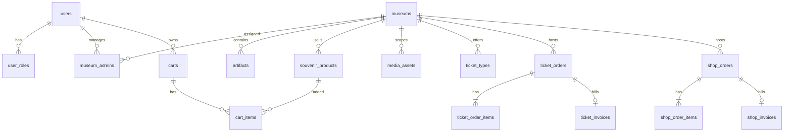

# Database Design (Demo) — Museum Management System

Postgres (Supabase-hosted) + Drizzle ORM demo using a traditional **application-first** Express.js + TypeScript backend, with Supabase used for data storage, Auth, and Storage. Not production: fake payments, VND only, no refunds, no audit log, no account deletion.

## 1. Rules

- **Application-first architecture:** Express connects directly to Postgres via `DATABASE_URL` using Drizzle ORM. The application layer owns all business logic, authorization/RBAC, validation, user provisioning, state transitions, cross-table rules, and multi-row transactional writes. Postgres is used strictly for data storage, relational/integrity constraints (FKs, `CHECK`s, indexes, `invoice_seq`), and atomic transactions — not for business triggers, PL/pgSQL RPCs, or PostgREST (`/rest/v1`) endpoints.
- **Defense-in-depth on `public` schema:** Direct client access via PostgREST (`/rest/v1`) is not part of the API. Tables keep RLS enabled (`.enableRLS()` in `src/db/schema/`) with **no public client policies**, blocking unmediated PostgREST reads/writes while Express operates over `DATABASE_URL` (authorization is enforced in Express, not RLS).
- One cart and one order belong to one museum.
- A ticket purchase is one order with `visit_date`, `time_slot`, one `entry_code`, and any number of ticket types. Slots are a fixed list; there is no capacity limit.
- Admins manage only museums where they have an `active` membership **and** the `admin_user` role. They cannot change totals, payment status, or issue refunds.
- The first `super_admin` is inserted by SQL. It creates museums and assigns admins.
- Catalog rows are archived, never hard-deleted. Users referenced by orders cannot be deleted.

## 2. Conventions

- Schema `public`; UUID PKs (`gen_random_uuid()`); `timestamptz` UTC; money `numeric(12,2)`.
- Every table has `id`, `created_at`, `updated_at`, except join tables (`user_roles`, `museum_admins`) and invoice tables (which use `issued_at`).
- `updated_at` is maintained by the application layer via Drizzle `$onUpdate` (`src/db/schema/_helpers.ts`) rather than a DB trigger.
- `currency` is `text` default `'VND'` with `CHECK (currency = 'VND')`.
- FKs declare `ON DELETE`. Columns marked “nullable” are optional; everything else is `NOT NULL`.

## 3. Enums

| Enum | Values |
|---|---|
| `app_role` | `normal_user`, `admin_user`, `super_admin` |
| `publication_status` | `draft`, `published`, `archived` |
| `media_type` | `image`, `video` |
| `media_entity_type` | `artifact`, `souvenir` |
| `ticket_order_status` | `pending`, `confirmed`, `used`, `cancelled` |
| `payment_status` | `unpaid`, `paid`, `failed` |
| `cart_status` | `active`, `converted`, `abandoned` |
| `shop_order_status` | `pending`, `confirmed`, `shipped`, `completed`, `cancelled` |
| `admin_membership_status` | `active`, `suspended`, `revoked` |

## 4. Relationships

## 5. Tables

**`users`** — `id` uuid PK, FK `auth.users(id)` cascade; `display_name` (nullable); `phone` (nullable); timestamps.

**`user_roles`** — `user_id` FK `users(id)` cascade; `role` `app_role`; PK `(user_id, role)`; `created_at`.

**`museums`** — `id`; `name`; `slug` unique; `description` (nullable); `address` (nullable); `city` (nullable); `cover_image_path` (nullable); `status` default `draft`; `created_by` FK `users(id)` set null (nullable); timestamps.

**`museum_admins`** — `museum_id` FK `museums(id)` cascade; `user_id` FK `users(id)` cascade; `status` default `active`; `assigned_by` FK `users(id)` set null (nullable); `assigned_at` default `now()`; `revoked_at` (nullable); PK `(museum_id, user_id)`. Re-assignment reuses the row; history is not kept.

**`artifacts`** — `id`; `museum_id` FK `museums(id)` restrict; `name`; `description` (nullable); `period` (nullable); `inventory_code` (nullable); `status` default `draft`; `created_by` FK `users(id)` set null (nullable); timestamps. Partial unique `(museum_id, inventory_code) WHERE inventory_code IS NOT NULL`.

**`souvenir_products`** — `id`; `museum_id` FK `museums(id)` restrict; `name`; `description` (nullable); `sku` (nullable); `price` `CHECK (price >= 0)`; `currency`; `stock_quantity` integer default 0 `CHECK (stock_quantity >= 0)`; `status` default `draft`; `created_by` FK `users(id)` set null (nullable); timestamps. Partial unique `(museum_id, sku) WHERE sku IS NOT NULL`.

**`media_assets`** — `id`; `museum_id` FK `museums(id)` cascade; `entity_type` `media_entity_type`; `entity_id` uuid; `media_type`; `storage_bucket`; `storage_path`; `mime_type`; `sort_order` default 0; `is_primary` default false; `created_by` FK `users(id)` set null (nullable); timestamps.

- Unique `(storage_bucket, storage_path)`; partial unique `(entity_type, entity_id) WHERE is_primary`.
- No FK is possible for `(entity_type, entity_id)`. Express services verify the target entity exists and belongs to the same `museum_id` before writing.

**`ticket_types`** — `id`; `museum_id` FK `museums(id)` restrict; `name`; `description` (nullable); `price` `CHECK (price >= 0)`; `currency`; `is_available` default true; timestamps.

**`ticket_orders`** — `id`; `user_id` FK `users(id)` restrict; `museum_id` FK `museums(id)` restrict; `visit_date` date; `time_slot` text `CHECK (time_slot IN ('09:00-11:00', '11:00-13:00', '14:00-16:00', '16:00-18:00'))`; `status` default `pending`; `payment_status` default `unpaid`; `total_amount` `CHECK (total_amount >= 0)`; `currency`; `entry_code` text unique (nullable until paid); `used_at` timestamptz (nullable); timestamps. One entry code and one time slot per order.

**`ticket_order_items`** — `id`; `ticket_order_id` FK `ticket_orders(id)` cascade; `ticket_type_id` FK `ticket_types(id)` restrict; `quantity` `CHECK (quantity > 0)`; `unit_price` `CHECK (unit_price >= 0)`; `line_total` generated always as `(unit_price * quantity)` stored; timestamps.

**`ticket_invoices`** — `id`; `ticket_order_id` uuid unique FK `ticket_orders(id)` restrict; `invoice_number` unique; `issued_at`; `billing_name`; `billing_email`; `total_amount`; `currency`.

**`carts`** — `id`; `user_id` FK `users(id)` cascade; `museum_id` FK `museums(id)` restrict; `status` default `active`; timestamps. Partial unique `(user_id, museum_id) WHERE status = 'active'`.

**`cart_items`** — `id`; `cart_id` FK `carts(id)` cascade; `product_id` FK `souvenir_products(id)` restrict; `quantity` `CHECK (quantity > 0)`; timestamps. Unique `(cart_id, product_id)`; Express services require the product to belong to the cart's museum.

**`shop_orders`** — `id`; `user_id` FK `users(id)` restrict; `museum_id` FK `museums(id)` restrict; `status` default `pending`; `payment_status` default `unpaid`; `subtotal` `CHECK (subtotal >= 0)`; `shipping_fee` default 0 `CHECK (shipping_fee >= 0)`; `total_amount` generated always as `(subtotal + shipping_fee)` stored; `currency`; `shipping_name`; `shipping_phone`; `shipping_address`; `shipping_city` (nullable); timestamps.

**`shop_order_items`** — `id`; `order_id` FK `shop_orders(id)` cascade; `product_id` FK `souvenir_products(id)` restrict; `product_name` snapshot; `unit_price` `CHECK (unit_price >= 0)`; `quantity` `CHECK (quantity > 0)`; `line_total` generated always as `(unit_price * quantity)` stored; timestamps.

**`shop_invoices`** — `id`; `order_id` uuid unique FK `shop_orders(id)` restrict; `invoice_number` unique; `issued_at`; `billing_name`; `billing_email`; `total_amount`; `currency`.

## 6. Indexes and constraints

- FK indexes: `artifacts(museum_id)`, `souvenir_products(museum_id)`, `ticket_types(museum_id)`, `ticket_orders(user_id, created_at desc)`, `ticket_orders(museum_id, visit_date, time_slot, status)`, `ticket_order_items(ticket_order_id)`, `ticket_order_items(ticket_type_id)`, `cart_items(cart_id)`, `cart_items(product_id)`, `shop_orders(user_id, created_at desc)`, `shop_orders(museum_id, created_at desc)`, `shop_order_items(order_id)`, `shop_order_items(product_id)`, `media_assets(museum_id, entity_type, entity_id, sort_order)`, `museum_admins(user_id, status)`.
- Public catalog: `museums(status, created_at)`, `artifacts(museum_id, status, created_at)`, `souvenir_products(museum_id, status, created_at)`.
- Partial unique: `carts(user_id, museum_id) WHERE status = 'active'`; `media_assets(entity_type, entity_id) WHERE is_primary`; `artifacts(museum_id, inventory_code) WHERE inventory_code IS NOT NULL`; `souvenir_products(museum_id, sku) WHERE sku IS NOT NULL`.
- `ticket_orders.entry_code` is `UNIQUE`; multiple `NULL`s are allowed.
- Quantities are positive; prices, fees, and totals are non-negative.
- Status transitions are enforced in Express services, not by CHECKs.

## 7. Auth and Authorization

1. Supabase Auth creates and manages `auth.users`.
2. Express idempotently provisions `public.users` and `user_roles(normal_user)` with `ON CONFLICT DO NOTHING` on the user's first authenticated request (`ensureUserProvisioned`), without relying on a DB signup trigger.
3. The `super_admin` creates museums and assigns `admin_user` + `museum_admins`.
4. Express verifies the caller's Bearer JWT via Supabase Auth (`supabase.auth.getUser(token)`) and queries `user_roles` and `museum_admins` from Postgres per request, so role/membership changes apply immediately.

| Data | `anon` | `normal_user` | `admin_user` | `super_admin` |
|---|---|---|---|---|
| Published museums/artifacts/products and available ticket types | Read | Read | Read | Read/Write |
| Draft/archived catalog | — | — | Read/Write in managed museums | Read/Write |
| Profile (`display_name`, `phone`) | — | Read/Update own | same | Read all |
| Roles/memberships | — | Read own | Read own | Read/Write via SQL (read via API) |
| Media of published entity | Read | Read | Read | Read/Write |
| Media writes | — | — | Managed museums | Read/Write |
| Carts/cart items | — | CRUD own | Own only | CRUD |
| Ticket/shop orders, invoices | — | Read own + create/cancel own via service | Read/Manage managed museums | Read/Manage all |
| Direct order/invoice field overrides | — | — | — | — |

- Public catalog queries must require `museums.status = 'published'`; a published artifact in a draft museum is not public.
- Order, item, invoice, payment, total, and `entry_code` writes happen only inside Express transactional services.
- Invoices are immutable: never updated or deleted by any endpoint.
- Profile updates accept `display_name` and `phone` only.

## 8. Transactional Operations (Express + Drizzle)

All multi-row and state-transition writes run inside `db.transaction(...)` with row locks where needed, validating the authenticated user and inputs.

**Purchase tickets (`POST /api/v1/ticket-orders`)**

1. Validate the museum is `published`, ticket types belong to it and are available; validate `visit_date` is today or later and `time_slot` matches the fixed list. "Today" uses `Asia/Ho_Chi_Minh` (`UTC+7`); the database stores timestamps in UTC. No capacity check.
2. Read current prices, set `unit_price`, compute `total_amount` (`line_total` is generated).
3. Insert `ticket_orders` and `ticket_order_items`.
4. Fake payment succeeds: `payment_status = 'paid'`, `status = 'confirmed'`, generate one unguessable `entry_code`.
5. Insert `ticket_invoices` with `invoice_number = 'TKT-' || nextval('invoice_seq')`.

**Checkout cart (`POST /api/v1/carts/:cartId/checkout`)**

1. Lock the cart and its items (`FOR UPDATE`); require the cart to be `active` and owned by the caller.
2. Lock products with `SELECT ... FOR UPDATE ORDER BY id`; re-check that the museum and products are `published`, plus current price and stock.
3. Insert `shop_orders` and `shop_order_items` with snapshots; compute `subtotal` and apply a server-side flat `shipping_fee` (`line_total` and `total_amount` are generated). Never accept the fee from the client.
4. Decrement stock conditionally (`WHERE stock_quantity >= qty`); zero affected rows rolls back the transaction.
5. Fake payment succeeds: `payment_status = 'paid'`, `status = 'confirmed'`; insert `shop_invoices` with `invoice_number = 'SHP-' || nextval('invoice_seq')`.
6. Mark the cart `converted`.

**Redeem entry (`POST /api/v1/admin/ticket-orders/redeem`)** — museum admin (or `super_admin`) only. Lock the order, verify its museum is managed, `status = 'confirmed'`, and `visit_date` equals today in `Asia/Ho_Chi_Minh`; set `status = 'used'`, `used_at = now()`. Rejects re-use.

**Update fulfillment (`PATCH /api/v1/admin/shop-orders/:id/fulfillment`)** — museum admin (or `super_admin`) only; allows `confirmed → shipped → completed`.

**Cancel ticket/shop order** — owner or museum admin; allowed while `confirmed` (ticket orders only before `visit_date` in `Asia/Ho_Chi_Minh`; shop orders only before `shipped`). Set `cancelled`; restore stock for shop orders. No refunds.

A shared `invoice_seq` sequence plus the `TKT-`/`SHP-` prefixes keeps invoice numbers globally unique.

## 9. Storage

- Two public buckets for the demo: `museum-media` and `souvenir-media`.
- Path: `{museum_id}/{entity_type}/{entity_id}/{random_filename}`; never use the original filename as identity.
- Express handles admin-only uploads/deletes (via Supabase Storage / S3-compatible API); validate file size, MIME type, extension, and museum admin permission server-side before writing `media_assets`.
- Public buckets mean anyone with a path can read the object. Use private buckets and signed URLs in production.
- Storage object deletion on `media_assets` delete is best-effort.

## 10. Out of scope

Real payments/webhooks, refunds, multi-currency/tax, audit log, membership history, account deletion/anonymization, stock reservations/history, capacity limits and configurable slots, multi-museum orders, per-person QR codes, notifications, search, backups/PITR.
